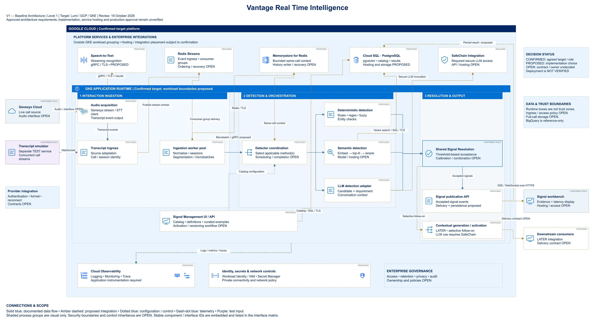
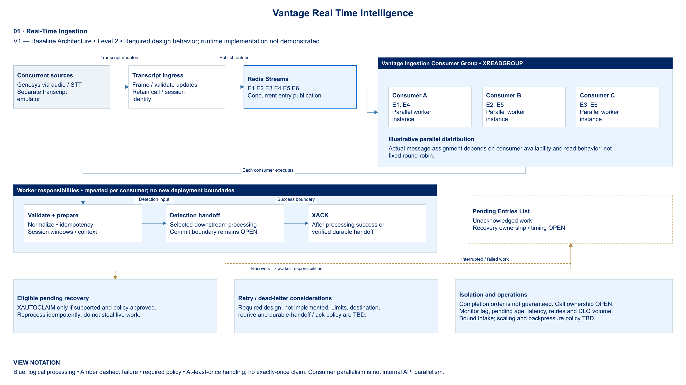
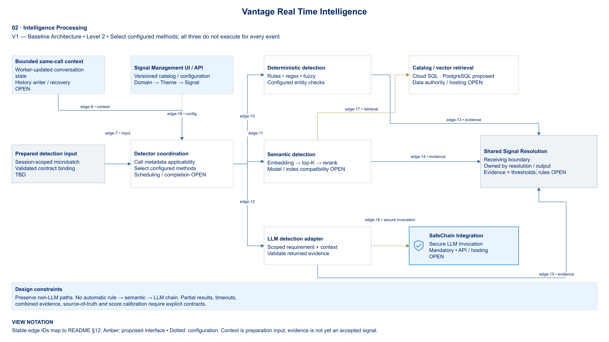
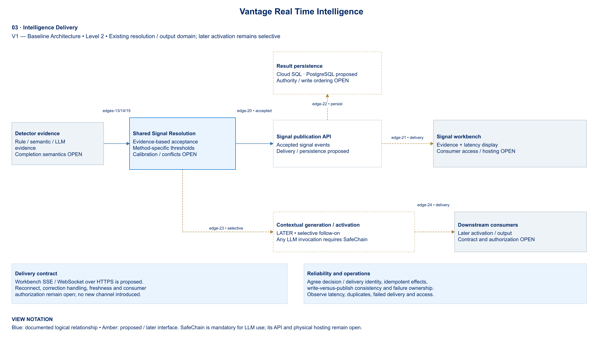
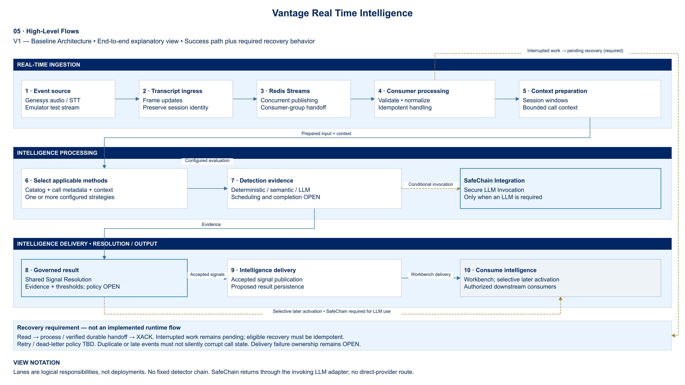

# Vantage Real Time Intelligence

**Architecture Version: V1 — Baseline Architecture**

## 1. Overview

Vantage identifies meaningful business signals during active customer conversations and makes accepted signals, evidence and latency information available to a workbench and authorized downstream consumers. The design separates real-time ingestion, selective intelligence processing, and resolution / delivery. Redis Streams is the approved ingress mechanism; SafeChain Integration is mandatory whenever an LLM is invoked. Security, privacy, governance and observability apply across these responsibilities.

This package is derived from the corrected V4 source at commit `ba3ffb91569d76a2c3b802ea889e53b785e5b006`. V1 is its consolidated published designation, not a redesign. Previous diagrams remain recoverable in Git history. The inspected repository contains architecture tooling, not application runtime code. A confirmed architectural requirement does not prove implementation or production approval. Review date: 19 October 2026.

## 2. V1 — Baseline Level 1 Architecture



[Editable draw.io](architecture/v1/level-1-architecture.drawio) · [SVG](architecture/v1/level-1-architecture.svg)

**Ingress:** Redis Streams. **Secure LLM Integration:** SafeChain Integration.

The authoritative view retains all 38 source graph elements, all 25 interface endpoint pairs, original ownership groupings and GCP/GKE boundaries. The source already contained the agreed Redis Streams and SafeChain corrections. V1 changes the baseline designation and provides five subordinate explanatory views.

Read left to right: source acquisition and transcript ingress feed Redis Streams; ingestion workers prepare session context; catalog-driven coordination selects deterministic, semantic or LLM methods; shared resolution accepts evidence-based signals; publication serves the workbench and selective later activation serves downstream consumers. SafeChain appears only on LLM-dependent paths. Platform-service placement is logical: SafeChain hosting, service availability and inherited enterprise controls remain subject to confirmation.

## 3. Core Objectives

Identify signals soon enough to influence the active conversation; preserve call identity, evidence and version lineage; support concurrent calls; select relevant signals from metadata; keep business configuration separate from runtime processing; deliver understandable outcomes and latency information. Discussed cases include semantic product claims, verbatim disclosures and prior-event-dependent checks. They require SME-approved examples and acceptance criteria before implementation.

The supplied catalog is currently Sales Compliance. Domain scope is not expanded to new business capabilities. No production latency SLA, throughput target, model, trained classifier, response-cache tier or graph platform is introduced. Reuse comes from source adapters, versioned definitions and common contracts, not a new framework.

## 4. Guiding Architectural Principles

| Principle | Application and constraint |
|---|---|
| Event-driven architecture | Redis Streams decouples entry publication from consumer processing; source streaming is not confused with a finalized processing event. |
| Modularity and loose coupling | Preserve source adapters, ingestion, configured detection, resolution and delivery responsibilities; boxes do not automatically imply separate deployments. |
| Contract-first design | Identify producer/consumer ownership, input/output schemas, correlation and failures before component implementation. |
| Reliability and idempotency | Design for redelivery, interrupted processing and repeat-safe state/output effects; no exactly-once claim. |
| Security and governance | Restrict transcript/evidence access, identify enterprise control ownership, and require SafeChain for LLM invocation. |
| Observability | Correlate calls, utterances, evaluations and outcomes; measure tail latency and failure/recovery without logging sensitive payloads unnecessarily. |
| Scalability | Consumers can process separate events concurrently; same-call ownership and ordering require a separate design decision. |
| Extensibility | Use versioned catalog definitions and existing integration boundaries; do not introduce unsupported detectors, stores or gateways. |
| Performance, cost and sustainability | Select necessary methods, bound in-flight work, measure resource/model use, and avoid unnecessary reprocessing. No arbitrary SLO or spend target is selected. |
| User-centric outcomes | Present evidence and freshness clearly; validate usefulness, false positives and false negatives with business SMEs. |

## 5. Major Architecture Domains

| Published domain | Existing Level 1 grouping | Ownership preserved |
|---|---|---|
| Real-Time Ingestion | Interaction Ingestion | Audio acquisition, transcript ingress, ingestion worker responsibilities; Redis delivery and bounded context are dependencies. |
| Intelligence Processing | Detection & Orchestration | Catalog applicability and selective deterministic, semantic and LLM detection; returns evidence. |
| Intelligence Delivery | Resolution & Output | Shared Signal Resolution, accepted-signal publication and later contextual generation / activation. |

The processing view shows Shared Signal Resolution as its receiving boundary, not an internal processing-owned component. Catalog management, state, persistence, SafeChain, telemetry and enterprise controls support these domains without new ownership assignments. The separate emulator is test-only. A direct provider transcript route is still a contract question; no new Level 1 connector is added. Earlier discussion about moving windowing to ingress does not override the current worker-side baseline.

## 6. Real-Time Ingestion Component Architecture



[Editable draw.io](architecture/v1/component-views/01-real-time-ingestion.drawio) · [SVG](architecture/v1/component-views/01-real-time-ingestion.svg)

Ingress frames identifiable source updates and preserves call/session metadata. Redis consumer-group workers validate the processing contract, normalize transcript data, apply idempotent handling and prepare bounded same-session windows before downstream handoff. These are worker responsibilities, not newly mandated services.

The illustration assigns Consumer A to E1/E4, B to E2/E5, and C to E3/E6. **Actual assignment depends on consumer availability and read behavior; it is not fixed round-robin.** Source applications may publish concurrently. Consumers within one group distribute separate stream entries; independent groups may consume those entries independently. Internal API concurrency for one event is not provided by a Redis consumer group and is not asserted here. See [Redis XREADGROUP documentation](https://redis.io/docs/latest/commands/xreadgroup/).

For the required acknowledged-processing design, reads create pending work. A worker acknowledges only after successful processing or verified durable handoff; the exact transaction boundary remains open. XACK removes the pending record, not the stream payload. See [Redis XACK documentation](https://redis.io/docs/latest/commands/xack/). Interrupted work remains pending; eligible recovery must respect ownership and be repeat-safe. XAUTOCLAIM is conditional on supported Redis version and approved recovery policy; no idle threshold or retry count is selected. See [Redis XAUTOCLAIM documentation](https://redis.io/docs/latest/commands/xautoclaim/).

Concurrent completion order is not guaranteed. If E1 and E4 belong to the same conversation, availability-based distribution must not be mistaken for safe session affinity. Sequence/revision handling, ownership and fencing remain open. Retention, persistence and failure policies constrain recovery; this diagram does not promise lossless operation under every outage. Monitor consumer lag, pending age/count, latency, retry/dead-letter volume and failure visibility; bound intake before scaling.

## 7. Intelligence Processing Component Architecture



[Editable draw.io](architecture/v1/component-views/02-intelligence-processing.drawio) · [SVG](architecture/v1/component-views/02-intelligence-processing.svg)

Coordination combines prepared detection input, bounded same-call context and catalog configuration to identify applicable signals and methods. A signal can select a single method or a supported combination; no mandatory rule → semantic → LLM sequence is introduced, and not every detector executes for every event.

Deterministic detection evaluates configured matching; semantic detection embeds, retrieves top-K candidates and reranks; the LLM adapter evaluates scoped requirements and context through SafeChain. Each returns evidence to shared resolution in the delivery domain. Model/index compatibility, method timeouts, partial completion, evidence combination and calibration need explicit contracts. Context history is not unlimited, and the writer/source of truth for prior accepted signals is unresolved.

Catalog-driven deterministic, semantic and LLM strategies remain selective. Semantic embedding → top-K retrieval → reranking is retained. The catalog models EXACT_PHRASE, REGEX, FUZZY, NER, SEMANTIC, LLM and CLASSIFIER metadata; that does not approve every family as a runtime component. Classifier execution remains deferred and no mandatory entity-extraction stage is added.

Shared resolution retains threshold-based acceptance as the existing boundary. Method-specific numeric semantics, evidence sufficiency, combination, partial completion, conflicts and finality remain open. Raw score is not automatically a probability. Multi-label means several accepted signals for one utterance; combining evidence for one signal and deriving a composite business signal are different concerns.

The catalog's action mappings describe signal-to-action metadata. Delivery/authorization/version retrieval remain open; mapping enabled state alone is not permission to perform an action. Workbench evidence and latency are established roles. No new API endpoint, acceptance formula or consumer is invented.

## 8. Intelligence Delivery Component Architecture



[Editable draw.io](architecture/v1/component-views/03-intelligence-delivery.drawio) · [SVG](architecture/v1/component-views/03-intelligence-delivery.svg)

Shared resolution applies evidence requirements and configured method-specific acceptance semantics. Accepted outputs flow to publication and the workbench; result persistence remains proposed. Selective later generation/activation follows its existing separate relationship from resolution and delivers to downstream consumers. Any later LLM invocation must use SafeChain.

Workbench SSE/WebSocket over HTTPS remains proposed. Result authority, decision/delivery identity, authorization, freshness, reconnect behavior, corrected outcomes and write-versus-publish ordering remain open. No additional delivery channel, store or automatically executed action is introduced. Delivery failures require visible ownership and idempotent effects; retry and consumer acknowledgement contracts are not yet supplied.

## 9. Component Interactions


[Editable draw.io](architecture/v1/integration-views/04-component-interactions.drawio) · [SVG](architecture/v1/integration-views/04-component-interactions.svg)

This is the integration view of the same baseline. All 25 original interface IDs map to §12. EVENT labels identify the asynchronous Redis handoff; DATA labels identify state/storage access; CONFIG identifies catalog configuration; LLM identifies secure invocation; TELEMETRY identifies cross-cutting monitoring. Other logical/API timing stays open unless documented. A proposed transport such as gRPC does not establish final completion semantics or a production endpoint.

Source audio/STT, emulator WebSocket, normalized input, retrieval and accepted outputs retain their source relationships. Interface IDs are traceability labels, not stream keys or API names. No internal SafeChain protocol is invented.

## 10. High-Level Processing Flows



[Editable draw.io](architecture/v1/integration-views/05-high-level-flows.drawio) · [SVG](architecture/v1/integration-views/05-high-level-flows.svg)

1. Acquire permitted live interaction input or an emulator transcript; frame identifiable updates in ingress.
2. Publish entries to Redis Streams and distribute work among consumers in the selected group.
3. Validate, normalize and handle duplicates; prepare windows and bounded same-call context.
4. Select applicable catalog signals and configured detection methods. Use SafeChain only for required LLM invocation.
5. Return method evidence to Shared Signal Resolution; produce accepted signals under agreed acceptance rules.
6. Publish for workbench consumption and proposed persistence. Selective later activation follows its separate approved logical path.
7. Acknowledge ingress work after the agreed successful-processing or verified durable-handoff boundary, not an assumed end-user delivery milestone.

Failure/recovery is a required design path, not a demonstrated runtime: interrupted work stays pending; recover only when ownership permits; reprocessing must be idempotent. Retry/dead-letter handling and downstream failure ownership remain open. Source corrections, duplicates and out-of-order completion cannot be silently treated as new independent business outcomes.

## 11. Component Responsibility Matrix

All named owners are roles to confirm. The catalog demo is documented in supplied material; its executable files are not present here. No component is labeled as a verified running service.

| Component / stable ID | Purpose and responsibilities | Inputs | Outputs | Dependencies / state ownership | Implementation status and owner to confirm |
|---|---|---|---|---|---|
| `gcp` — Google Cloud / Lumi boundary | Define target platform scope | Approved enterprise service requirements | Available platform capabilities | Platform dependency; encloses GKE and candidate managed services; Platform configuration; operational owner TBD | Planned / runtime not demonstrated; Lumi / enterprise architecture |
| `gke` — GKE application runtime | Host target application workloads | Deployable application components, when implemented | Running workloads and platform telemetry | Runtime boundary; owns no business interface by itself; Cluster configuration; application state owned separately | Planned / runtime not demonstrated; Platform / SRE |
| `genesys` — Genesys Cloud | Provide live interaction source | Active call stream and authorized subscription | Audio/transcript source updates; actual contract TBD | External source; edge-1 to audio acquisition; text route not added to V1; Provider call identity and source lifecycle | Planned / runtime not demonstrated; Integration / Genesys |
| `test` — Transcript emulator | Exercise concurrent calls as a separate test source | Synthetic transcript fixtures | WebSocket transcript updates | edge-4 to ingress; same selected downstream processing path; Fixture/session progression | Planned / runtime not demonstrated; Test / ingestion |
| `provider` — Provider integration | Describe source authentication, format and reconnect responsibilities | Provider contract and access configuration | Source integration behavior | V1 support box has no explicit execution connector; boundary with bridge/ingress TBD; Credential references and session continuity; owner TBD | Planned / runtime not demonstrated; Integration |
| `bridge` — Audio acquisition | Adapt permitted live audio for speech recognition | Genesys audio; codec/frame format TBD | Transcript updates from STT interaction | edge-1 input; edge-2 STT dependency; edge-3 ingress output; Active audio/STT session state | Planned / runtime not demonstrated; Integration / speech |
| `stt` — Speech-to-Text | Produce transcript updates for proposed audio path | Approved audio stream | Partial/final recognition results; source contract TBD | edge-2 bidirectional dependency; gRPC/TLS shown as proposal; Recognition sessions; retention unspecified | Planned / runtime not demonstrated; Speech / Lumi |
| `ingress` — Transcript ingress | Adapt and frame identifiable transcript updates | Source/emulator updates | Identifiable processing entries | edges-3/4 input; edge-5 handoff; Redis required, binding remains open; Source-to-session mapping; publication work | Planned / runtime not demonstrated; Ingestion |
| `queue` — Redis Streams | Authoritative real-time stream handoff | Ingress processing entries | Consumer-group delivery under required Redis contract | edges-5/6; publish entries and consumer-group delivery; detailed transport binding open; Pending delivery and retained entries; not conversation truth | Planned / runtime not demonstrated; Architecture / platform |
| `worker` — Ingestion worker pool | Prepare coherent per-session detection input | Stream deliveries | Normalized windows / detection requests | edge-6 input; edge-7 coordination; edge-8 context update; Per-call progress, buffers and window state | Planned / runtime not demonstrated; Ingestion / detection |
| `state` — Memorystore for Redis | Provide bounded same-call working context | Worker context updates | Same-call context for coordination | edge-8 update; edge-9 context read; managed product proposed; Derived context; prior accepted-history writer unassigned | Planned / runtime not demonstrated; Data / ingestion |
| `management` — Signal Management UI / API | Maintain versioned taxonomy and detection configuration | Curated definitions, patterns, examples and detector metadata | Published catalog snapshot and configuration; action mappings | edge-18 coordination; edge-19 proposed persistence; action delivery binding TBD; Catalog authority and snapshot lifecycle; owner TBD | Documented external catalog demo; repository runtime absent; Catalog / business SME |
| `sql` — Cloud SQL · PostgreSQL | Candidate catalog, vector and result storage | Catalog writes, vector queries, proposed result writes | Snapshot/example/candidate/result data | edges-17/19/22; PostgreSQL/vector direction; Cloud SQL hosting proposed; Separate data categories; authority and transaction boundaries TBD | Planned / runtime not demonstrated; Data / Lumi |
| `coord` — Detector coordination | Select applicable signals and configured methods | Detection request, context, catalog snapshot | Scoped method requests | edges-7/9/18 inputs; edges-10/11/12 methods; schedule open; In-flight evaluation/version references | Planned / runtime not demonstrated; Detection |
| `rules` — Deterministic detection | Evaluate configured rules/matching | Selected request and rule configuration | Method evidence | edge-10 input; edge-13 resolver; internal protocol TBD; Rule/config version; does not own call history | Planned / runtime not demonstrated; Detection / SME |
| `semantic` — Semantic detection | Embed, retrieve top-K and rerank | Selected input and compatible examples/index | Reranked method evidence | edge-11 input; edge-17 retrieval; edge-14 resolver; Model/index/example provenance | Planned / runtime not demonstrated; ML / data |
| `llm` — LLM detection adapter | Evaluate scoped requirement/context through mandatory SafeChain | Selected request, requirement, permitted context | Validated LLM evidence | edge-12 input; edge-15 resolver; edge-16 uses mandatory SafeChain Integration; Prompt/model/catalog/evaluation provenance | Planned / runtime not demonstrated; AI platform / security |
| `model` — SafeChain Integration | Mandatory enterprise integration for secure access to approved LLM models | SafeChain-mediated request under contract TBD | Response through SafeChain to caller | edge-16 secure LLM invocation; SafeChain API / protocol open; Integration/model version; no new credentials/config invented | Planned / runtime not demonstrated; AI platform / Lumi |
| `resolver` — Shared Signal Resolution | Accept method evidence under configured signal rules | Method evidence and completion/configuration references | Accepted detections | edges-13/14/15 in; edge-20 publication; edge-23 selective later work; Decision identity, dedup and finality owner TBD | Planned / runtime not demonstrated; SME / ML |
| `publisher` — Signal publication API | Deliver accepted signals | Accepted multi-label envelope | Consumer delivery and proposed persisted result | edge-20 input; edge-21 workbench; edge-22 proposed SQL; Delivery progress; authoritative result store TBD | Planned / runtime not demonstrated; API / data |
| `workbench` — Signal workbench | Display actionable evidence and latency for review | Authorized accepted detections | User-visible signal review | edge-21; SSE/WebSocket over HTTPS remains proposal; Display session state; not business source of truth | Planned / runtime not demonstrated; UI / product |
| `later` — Contextual generation / activation | Provide selective later follow-on after acceptance | Accepted signal and authorized action/context configuration | Downstream activation output | edge-23 input; edge-24 consumers; any LLM invocation must use SafeChain; Action/effect tracking and context authority TBD | Planned / runtime not demonstrated; Product / downstream |
| `consumers` — Downstream consumers | Consume later intelligence/activation under agreed contracts | Authorized output/action request | Consumer outcome or acknowledgement, contract TBD | edge-24; delivery contract open; Consumer-side effect/dedup responsibility TBD | Planned / runtime not demonstrated; Downstream |
| `telemetry` — Cloud Observability | Collect logs, metrics and traces | Approved runtime operational signals | Correlated operational evidence | edge-25 aggregate telemetry; logging/monitoring/trace proposed; Operational retention and audit access TBD | Planned / runtime not demonstrated; SRE / application owners |
| `controls` — Identity, secrets & network controls | Provide agreed enterprise/application control boundary | Identity/access/config requirements | Approved auth, secrets and connectivity controls | Cross-cutting; no new gateway/service inferred; Control configuration and secret references | Planned / runtime not demonstrated; Security / Lumi |
| `governance` — Enterprise governance | Define access, retention, privacy and audit accountability | Data/model/operating requirements | Approved governance decisions and review requirements | Cross-cutting ownership; no automatic runtime workflow implied; Policy decisions, approval evidence and retention authority | Planned / runtime not demonstrated; Enterprise governance / privacy |

## 12. Component Interface and Contract Matrix

**Status vocabulary:** Implemented requires executable evidence; Approved identifies agreed logical requirements; Proposed identifies unapproved technology/protocol choices; TBD identifies missing contracts or ownership. None of the application interfaces below is demonstrated implemented by this architecture repository. Approved logical relationships do not approve every field or transport detail.

| Interface | Producer | Consumer | Communication mechanism | Input → output contract | Schema reference | Error responsibility / open binding | Owner to confirm | Contract status |
|---|---|---|---|---|---|---|---|---|
| `edge-1` | genesys | bridge | Live audio source; provider interface OPEN | Audio/transcript source updates; actual contract TBD → Genesys audio; codec/frame format TBD | No final wire schema supplied; detailed design TBD | genesys owns failure visibility; bridge validates/reports receipt or rejection. Reconnect, source permissions and encoding | Integration / Genesys / Integration / speech | Approved logical relationship; proposed/TBD transport and schema |
| `edge-2` | bridge | stt | Audio request / transcript response; gRPC/TLS proposed | Transcript updates from STT interaction → Approved audio stream | No final wire schema supplied; detailed design TBD | bridge owns failure visibility; stt validates/reports receipt or rejection. Finality, correction, speech ownership and timeout | Integration / speech / Speech / Lumi | Approved logical relationship; proposed/TBD transport and schema |
| `edge-3` | bridge | ingress | Identifiable transcript events | Transcript updates from STT interaction → Source/emulator updates | No final wire schema supplied; detailed design TBD | bridge owns failure visibility; ingress validates/reports receipt or rejection. Canonical source envelope and continuity | Integration / speech / Ingestion | Approved logical relationship; proposed/TBD transport and schema |
| `edge-4` | test | ingress | Documented WebSocket emulator input | WebSocket transcript updates → Source/emulator updates | No final wire schema supplied; detailed design TBD | test owns failure visibility; ingress validates/reports receipt or rejection. Fixture conformity, disconnect/revision cases | Test / ingestion / Ingestion | Approved logical relationship; proposed/TBD transport and schema |
| `edge-5` | ingress | queue | Redis Streams entry publication | Identifiable processing entries → Ingress processing entries | No final wire schema supplied; detailed design TBD | ingress owns failure visibility; queue validates/reports receipt or rejection. Envelope, names, publish retry identity and durability | Ingestion / Architecture / platform | Approved logical relationship; proposed/TBD transport and schema |
| `edge-6` | queue | worker | Redis Streams consumer-group delivery | Consumer-group delivery under required Redis contract → Stream deliveries | No final wire schema supplied; detailed design TBD | queue owns failure visibility; worker validates/reports receipt or rejection. Ownership, pending recovery, idempotency and ack boundary | Architecture / platform / Ingestion / detection | Approved logical relationship; proposed/TBD transport and schema |
| `edge-7` | worker | coord | Microbatch / detection input; gRPC remains original proposal | Normalized windows / detection requests → Detection request, context, catalog snapshot | Detection input below; window binding TBD | worker owns failure visibility; coord validates/reports receipt or rejection. Utterance-to-window mapping and completion contract | Ingestion / detection / Detection | Approved logical relationship; proposed/TBD transport and schema |
| `edge-8` | worker | state | Recent conversation-state update; Redis/TLS proposed | Normalized windows / detection requests → Worker context updates | No final wire schema supplied; detailed design TBD | worker owns failure visibility; state validates/reports receipt or rejection. Atomicity, expiry and reconstruction | Ingestion / detection / Data / ingestion | Approved logical relationship; proposed/TBD transport and schema |
| `edge-9` | state | coord | Same-call context; read packaging OPEN | Same-call context for coordination → Detection request, context, catalog snapshot | No final wire schema supplied; detailed design TBD | state owns failure visibility; coord validates/reports receipt or rejection. Missing state versus empty history | Data / ingestion / Detection | Approved logical relationship; proposed/TBD transport and schema |
| `edge-10` | coord | rules | Configured deterministic request | Scoped method requests → Selected request and rule configuration | No final wire schema supplied; detailed design TBD | coord owns failure visibility; rules validates/reports receipt or rejection. Invalid config, deadline and evidence schema | Detection / Detection / SME | Approved logical relationship; proposed/TBD transport and schema |
| `edge-11` | coord | semantic | Selected semantic evaluation | Scoped method requests → Selected input and compatible examples/index | No final wire schema supplied; detailed design TBD | coord owns failure visibility; semantic validates/reports receipt or rejection. Index/model compatibility and timeout | Detection / ML / data | Approved logical relationship; proposed/TBD transport and schema |
| `edge-12` | coord | llm | Selected scoped LLM evaluation | Scoped method requests → Selected request, requirement, permitted context | No final wire schema supplied; detailed design TBD | coord owns failure visibility; llm validates/reports receipt or rejection. SafeChain request/response binding and deadline | Detection / AI platform / security | Approved logical relationship; proposed/TBD transport and schema |
| `edge-13` | rules | resolver | Deterministic evidence | Method evidence → Method evidence and completion/configuration references | No final wire schema supplied; detailed design TBD | rules owns failure visibility; resolver validates/reports receipt or rejection. Do not invent confidence probability | Detection / SME / SME / ML | Approved logical relationship; proposed/TBD transport and schema |
| `edge-14` | semantic | resolver | Reranked semantic evidence | Reranked method evidence → Method evidence and completion/configuration references | No final wire schema supplied; detailed design TBD | semantic owns failure visibility; resolver validates/reports receipt or rejection. Score semantics/calibration and missing candidates | ML / data / SME / ML | Approved logical relationship; proposed/TBD transport and schema |
| `edge-15` | llm | resolver | Validated LLM evidence | Validated LLM evidence → Method evidence and completion/configuration references | No final wire schema supplied; detailed design TBD | llm owns failure visibility; resolver validates/reports receipt or rejection. Malformed output, missing evidence and late results | AI platform / security / SME / ML | Approved logical relationship; proposed/TBD transport and schema |
| `edge-16` | llm | model | Secure LLM invocation through SafeChain Integration | Validated LLM evidence → SafeChain-mediated request under contract TBD | No final wire schema supplied; detailed design TBD | llm owns failure visibility; model validates/reports receipt or rejection. No bypass; API/auth/config/error contracts not supplied | AI platform / security / AI platform / Lumi | Approved logical relationship; proposed/TBD transport and schema |
| `edge-17` | semantic | sql | Vector query/results; SQL/TLS proposed | Reranked method evidence → Catalog writes, vector queries, proposed result writes | No final wire schema supplied; detailed design TBD | semantic owns failure visibility; sql validates/reports receipt or rejection. Compatible index, retrieval failures and data access | ML / data / Data / Lumi | Approved logical relationship; proposed/TBD transport and schema |
| `edge-18` | management | coord | Versioned catalog configuration; fetch/push OPEN | Published catalog snapshot and configuration; action mappings → Detection request, context, catalog snapshot | No final wire schema supplied; detailed design TBD | management owns failure visibility; coord validates/reports receipt or rejection. Snapshot selection/pinning/rollback | Catalog / business SME / Detection | Approved logical relationship; proposed/TBD transport and schema |
| `edge-19` | management | sql | Proposed catalog/example persistence | Published catalog snapshot and configuration; action mappings → Catalog writes, vector queries, proposed result writes | No final wire schema supplied; detailed design TBD | management owns failure visibility; sql validates/reports receipt or rejection. Authority, validation and publication consistency | Catalog / business SME / Data / Lumi | Approved logical relationship; proposed/TBD transport and schema |
| `edge-20` | resolver | publisher | Accepted multi-label output | Accepted detections → Accepted multi-label envelope | Accepted output below; transport binding TBD | resolver owns failure visibility; publisher validates/reports receipt or rejection. Finality, duplicates and internal failure statuses | SME / ML / API / data | Approved logical relationship; proposed/TBD transport and schema |
| `edge-21` | publisher | workbench | Delivery; SSE/WebSocket over HTTPS proposed | Consumer delivery and proposed persisted result → Authorized accepted detections | Accepted output below; transport binding TBD | publisher owns failure visibility; workbench validates/reports receipt or rejection. Access, reconnect, latency and corrected outcomes | API / data / UI / product | Approved logical relationship; proposed/TBD transport and schema |
| `edge-22` | publisher | sql | Proposed accepted-result persistence | Consumer delivery and proposed persisted result → Catalog writes, vector queries, proposed result writes | Accepted output below; transport binding TBD | publisher owns failure visibility; sql validates/reports receipt or rejection. Write/publish ordering and evidence retention | API / data / Data / Lumi | Approved logical relationship; proposed/TBD transport and schema |
| `edge-23` | resolver | later | Selective follow-on after acceptance | Accepted detections → Accepted signal and authorized action/context configuration | No final wire schema supplied; detailed design TBD | resolver owns failure visibility; later validates/reports receipt or rejection. Trigger and action authorization; SafeChain for any LLM calls | SME / ML / Product / downstream | Approved logical relationship; proposed/TBD transport and schema |
| `edge-24` | later | consumers | Later activation delivery; contract OPEN | Downstream activation output → Authorized output/action request | No final wire schema supplied; detailed design TBD | later owns failure visibility; consumers validates/reports receipt or rejection. Idempotent effects, authorization and failure visibility | Product / downstream / Downstream | Approved logical relationship; proposed/TBD transport and schema |
| `edge-25` | gke | telemetry | Logs/metrics/traces; cross-cutting collection | Running workloads and platform telemetry → Approved runtime operational signals | No final wire schema supplied; detailed design TBD | gke owns failure visibility; telemetry validates/reports receipt or rejection. Redaction, retention, correlation and alert ownership | Platform / SRE / SRE / application owners | Approved logical relationship; proposed/TBD transport and schema |

### Supplied detection schemas and versioning


The supplied Signal Catalog Technical Specification v1.0 (2026-10-16) is the source of these fields. Its executable catalog.json/server.py/index.html/workbook were not available. Missing detailed schemas have not been reconstructed from guesses.

### Detection input

| Field | Type | Required | Constraint |
|---|---|---|---|
| request_id | STRING | Yes | Nonempty unique detection request identity |
| session_id | STRING | Yes | Nonempty; partition context by session |
| utterance_id | STRING | Yes | Source utterance identity, unique within session |
| sequence_number | INTEGER | Yes | Within-call order, nonnegative |
| speaker | ENUM | Yes | AGENT / CUSTOMER / UNKNOWN |
| text | STRING | Yes | Final transcript text; nonempty after normalization |
| event_timestamp | TIMESTAMP | Yes | UTC ISO-8601 source event time |
| is_final | BOOLEAN | Yes | False handled by buffering policy, details unspecified |
| context | JSON_ARRAY | No | Prior speaker-tagged utterances; same session only |
| catalog_version | STRING | Yes | Immutable published snapshot identifier |

An utterance-oriented contract does not yet specify multi-utterance window identity, corrections or prior-signal state. Do not append fields or reinterpret sequence_number without agreement.

### Accepted output

| Field | Type | Required | Constraint |
|---|---|---|---|
| request_id, session_id, utterance_id | STRING each | Yes | Same as input |
| catalog_version | STRING | Yes | Snapshot used, consistent in response |
| status | ENUM | Yes | SUCCESS / ERROR; do not mask failures |
| detections | JSON_ARRAY | Yes | Accepted signal objects; multi-label |
| detections[].signal_id | STRING | Yes | Exists in catalog |
| detections[].domain_id, theme_id | STRING each | Yes | Catalog-derived |
| detections[].detection_type | STRING | Yes | Registered detector |
| detections[].score | FLOAT | No | Raw score, may be non-probabilistic |
| detections[].score_type | STRING | Yes | Meaning such as RULE_MATCH / COSINE |
| detections[].evidence | JSON_OBJECT | Yes | Minimize sensitive data; detailed per-method schema missing |
| detections[].latency_ms | INTEGER | Yes | Nonnegative inference latency |
| detections[].signal_version | INTEGER | Yes | Positive version integer |

No additional status enum, partial-error shape, confidence conversion or correction format is invented. Example evidence matched_text/matched_utterance_id is not a complete universal evidence schema. The singular detection_type requires alignment with combined-method evidence.

### Catalog and compatibility

Current catalog taxonomy is **Domain → Theme → Signal**, scoped to `SALES_COMPLIANCE`. A domain has many themes; a theme has many signals; a signal has many patterns, examples, detector records, action mappings and source-audit records. Local catalog.json arrays are domains, themes, signals, patterns, examples, detectors, actions and sources. These are entities, not separate services or an approved production storage choice.

The specification requires immutable IDs, catalog snapshot versioning, signal-version increments when meaning changes, detector metadata version alignment and release notes. Preserve category as the theme-identifier alias until consumers migrate to theme_id. Prefer additive compatible schema changes. Compatibility enforcement and migration ownership require design.

Recommended catalog validation includes reference/uniqueness checks, required fields, current-domain enforcement, numeric type checks and per-detector config_json validation. Full detector schemas are not supplied. Suggested lifecycle DRAFT_REVIEW → APPROVED → ACTIVE → DEPRECATED does not establish an implemented approval workflow.

### Data ownership

| Data | Authority / storage status | Required design |
|---|---|---|
| Source transcript/revision | Provider authority and canonical revision contract open | Identity, revision, source sequence and retention |
| Redis entries / pending delivery | Processing transport state, not catalog/evidence authority | Persistence, retention, retries and checkpoints |
| Bounded context/windows | Derived same-session working state | Ownership, consistency, expiry, recovery |
| Catalog | Business/catalog ownership TBD; demo JSON only reported | Published snapshot source, approval, rollback |
| Examples / vectors | Curated examples plus derived index; PostgreSQL/vector direction retained | Version lineage, rebuild/delete and hosting |
| Decisions / accepted history | Source of truth and writer TBD; SQL mapping proposed | Evidence retention, dedup, write/publish consistency |
| Logs/traces | Operational evidence, not substitute for business history | Redaction, access, retention and sampling |

## 13. Redis Streams Architecture Considerations

Redis Streams is mandatory, not an alternative. No runtime broker code exists in the inspected repository. This package documents required behavior; Redis processing is not implemented here.

All unspecified items below are **TBD — Detailed Design Decision Required**. These tables identify the engineering contract to agree; they do not introduce invented production values.

### Producer

| Item | Agreed requirement / unresolved binding |
|---|---|
| Stream names and naming convention | TBD; no actual stream keys exist in repository |
| Source adapter responsibility | Frame identifiable transcript updates; retain session/source metadata; use synthetic data for emulator |
| Event envelope / serialization | TBD; do not assume supplied detection input is the Redis envelope |
| Schema version | Required design concern; field name, registry and compatibility policy TBD |
| Event ID / idempotency | Stable logical identity across publish retries required; field/key derivation TBD; Redis entry ID alone does not define business identity |
| Correlation / source | Preserve source and call/session correlation; mapping to detection request_id/session_id/utterance_id TBD |
| Event timestamp | Preserve actual source time where available; required detection event_timestamp is UTC ISO-8601; missing-source policy TBD |
| Payload | Transcript update and supplied metadata; revision/finality/source sequence and metadata binding TBD |
| Validation | Framing, permitted size and required envelope checks before publication; detector input validation separately at its boundary |
| Publish failure | Do not report successful downstream delivery; stable retry identity, backoff, limits and caller response TBD |
| Partial/final handling | Preserve available finality information; exact buffering, revision and publication behavior TBD |

### Consumer

| Item | Required behavior / unresolved binding |
|---|---|
| Consumer group strategy | Redis groups required; names, group count, partition mapping and assignment TBD |
| Consumer identity | Distinguishable worker identity; format and restart lifecycle TBD |
| Processing ownership | Prevent conflicting same-call state mutation; ownership lease/fencing or equivalent is not selected |
| Acknowledgement | After successful processing or verified durable handoff; exact context/job/output commit boundary TBD |
| Pending recovery | Inspect unfinished work and reclaim safely after ownership/liveness decision; command/version compatibility, idle threshold and batch size TBD |
| Retry | Repeat-safe handling, attempt tracking, retryable versus permanent classification; budgets/backoff TBD |
| Dead-letter | Required target; stream/location, payload minimization, redrive authorization, retention and commit/ack consistency TBD |
| Idempotency | Cover context changes, detector scheduling and publication effects; key, state store and retention TBD |
| Processing timeout | Deadline/claim interaction TBD; avoid recovery taking work from a still-authorized healthy processor |
| Shutdown/restart | Stop intake, complete or durably hand off eligible work, preserve pending recovery; grace period and reassignment TBD |
| Contract failures | Invalid input must remain visible; exact error and dead-letter classification TBD |

### Delivery and operation

| Concern | Contract obligation |
|---|---|
| Delivery semantics | Design for duplicate/redelivered work and at-least-once handling within approved persistence/retention; end-to-end guarantees must be measured |
| Ordering | Stream order is not source event-time order or concurrent completion order; define sequence/revision and same-call processing rules |
| Replay | Distinguish operational recovery, context reconstruction and user-visible redelivery; authorization, start point and stale-event handling TBD |
| Checkpoints | Define processing/context/output progress and commit consistency; acknowledgement alone is not a business checkpoint |
| Retention/trimming | Set bounds after deciding pending recovery, consumer progress, replay window and memory budget; never assume XACK deletes stream payload |
| Lag/pending | Monitor unread backlog, pending age/count, processing age and recoveries; alert thresholds TBD |
| Backpressure | Bound intake and in-flight work; overload admission/throttle behavior TBD; no silent drop policy |
| Capacity/availability | Measure memory, event size/rate, active calls, Redis outages/failover and downstream bottlenecks |

A worker crash after state update but before durable scheduling is a critical consistency case. Another is successful output followed by failure before acknowledgement. Neither is solved merely by adding a retry loop.

## 14. Security and Governance

SafeChain Integration provides the enterprise-secured interface for LLM invocation within Vantage Real Time Intelligence.

SafeChain is mandatory for LLM calls; this package does not specify its internal API, authentication, routing or security implementation. Non-LLM rules and vector operations are not made LLM-dependent. Actual integration availability and enterprise control evidence must be confirmed.

SafeChain is mandatory for LLM invocation. Its specific internal controls are not invented. Lumi and enterprise owners must confirm source permissions, approved services, project/network connectivity, workload identities, secrets/keys, model access, data classification, retention/deletion and audit responsibility.

Proposed platform-owned controls include organization/project/network foundations, cluster baselines and approved identity/secret services. Application-owned concerns include scoped access, call isolation, payload validation, permitted context, evidence handling and failure visibility. Inheritance is not proven by the V1 boxes. Regulatory catalog references are metadata requiring SME validation, not legal conclusions.

Golden datasets, false-positive/negative analysis, human review and prompt/model/index/catalog provenance remain evaluation requirements. No automatic retraining or new governance runtime is introduced. Dead-letter records and logs require permitted minimal data; raw transcript logging is not assumed safe.

## 15. Reliability and Operational Readiness

Redis delivery must support consumer groups, acknowledgement after success/durable handoff, pending recovery, retry/dead-letter, idempotency, ordering considerations, retention/trimming, replay and consumer restart. Actual names, commands/version compatibility, budgets and ownership mechanisms remain TBD.

Define the commit boundary across context updates, detector scheduling, accepted-result persistence, publication and acknowledgement. Recovery can repeat work; protect effects as well as messages. Retained Redis entries are not automatically the business system of record. Approved persistence/failover is required before claiming durable handoff.

A slow LLM must not cause unlimited queued work. Completion, timeout, late evidence and SafeChain failures require explicit semantics. No direct-model bypass is proposed. Missing context is not empty context; failed evaluation is not a negative business finding. Freshness for display, context reconstruction and evidence retention are separate policies.

No exactly-once, zero-latency or generally acceptable silent loss guarantee is approved. Test failures around each commit/ack boundary and prevent concurrent ownership after recovery. Prior-signal visibility remains unassigned rather than silently adding a writeback connection.

Measure source/transcription delay separately from queue/window wait, method execution, resolution, publication and visible delivery. Use P50/P95/P99 under agreed workload and failure conditions; no numerical SLO is inferred from examples. Track Redis lag/pending age, retry/dead-letter rates, memory/capacity, concurrent sessions, state errors, detector completion, evidence quality and resource/model cost.

Propagate request/session/utterance and catalog/signal identifiers; model/prompt/index and trace bindings remain TBD. SafeChain-specific fields must come from its actual contract. Redact sensitive content and assign alert ownership. Logging/Monitoring/Trace in V1 are proposed tooling, not demonstrated instrumentation.

The architecture is ready for contract review, not operational approval. Source evidence, Lumi controls, SafeChain integration, recovery guarantees, quality and capacity results are still required.

| Scenario to validate before implementation approval | Required outcome / decision |
|---|---|
| Multiple calls interleave | Correlation and bounded context remain isolated; same-call ownership strategy explicitly agreed. |
| Worker stops before acknowledgement | Pending work remains visible; safe recovery does not race a live authorized owner. |
| Worker updates state then stops before acknowledgement | Redelivery does not duplicate context, scheduling or accepted output effects. |
| Source revises an utterance or completion order changes | Revision/sequence rules determine whether to update, reject or defer; no invented automatic policy. |
| Redis / context unavailable | Distinguish unavailable state from empty history; agree admission, degradation and recovery behavior. |
| Selected detector times out or returns invalid evidence | Explicit partial/failure semantics; no silent acceptance or direct-model bypass. |
| Persistence or delivery fails | Agreed ownership, idempotency and visibility; no unsupported end-to-end delivery guarantee. |

## 16. Principal Architect Assessment

**Strengths:** preserved domain boundaries; catalog-led selective detection; explicit secure LLM boundary; separate resolution and later activation; traceable interfaces; concurrent-ingestion and recovery concerns made visible.

**Critical readiness gaps:** same-call ownership under parallel consumption; acknowledgement/state/output consistency; evidence and acceptance semantics; provider finality/revisions; actual SafeChain integration contract; result authority and downstream authorization. These are unverified decisions or absent implementation evidence, not proof of defects in an unseen deployment.

The package is ready for leadership and component contract-design review. It is not a production approval artifact. The review covers all six views; Level 2 stages remain explanatory responsibilities and do not mandate new deployments.

The following component-by-component checks cover responsibility, interaction, reliability, security, scaling and observability. **Readiness for every runtime component: detailed design can start; implementation acceptance cannot be claimed.** Named owners are TBD. Absence of documentation is not asserted as a defect in unseen implementation.

| Component | Reliability / error and retry responsibility | Security / governance | Performance and observability | Developer readiness gap |
|---|---|---|---|---|
| Google Cloud / Lumi boundary (`gcp`) | Availability and inherited recovery guarantees must be supplied | Project, network, identity and key controls require Lumi confirmation | Service availability, quotas and cost; limits TBD | Service approvals and control inheritance unverified |
| GKE application runtime (`gke`) | Workload shutdown/restart and failure-isolation contracts missing | Workload identity and network enforcement require approval | Workload saturation, restart and resource consumption; limits TBD | Boxes are not approved independent Deployments |
| Genesys Cloud (`genesys`) | Disconnect/reconnect, gaps and source ordering unverified | Source permissions and permitted capture must be confirmed | Source delay, gaps and reconnects; limits TBD | Selected topic/payload and live audio availability not evidenced |
| Transcript emulator (`test`) | Specify reproducible disconnect, revision and overload cases | Synthetic/redacted inputs; no production secrets | Fixture sequence, call count and emitted/received counts; limits TBD | No emulator code supplied |
| Provider integration (`provider`) | Reconnect ownership must not overlap with ingress/bridge | Do not infer auth scheme from box label | Authentication failures and reconnect outcomes; limits TBD | Responsibility overlaps acquisition and ingress unless assigned |
| Audio acquisition (`bridge`) | Define continuity, buffering and recovery after STT disconnect | Approved audio capture and STT data handling | Audio receipt-to-transcript delay and dropped frames; limits TBD | Audio and STT ownership unclear |
| Speech-to-Text (`stt`) | Specify timeout, reconnect and correction behavior | Approved audio service and permitted processing location | Recognition delay, quality and service errors; limits TBD | Service/protocol/version not confirmed |
| Transcript ingress (`ingress`) | Publish failure, backpressure and stable retry identity required | Validate payload and source authorization; no invented fields | Ingress delay, invalid updates and publish failures; limits TBD | Transport envelope and metadata mapping missing |
| Redis Streams (`queue`) | Ack after success/durable handoff; pending recovery, retry, DLQ, replay and idempotency required | Approved Redis access/hosting and restricted payload retention | Lag, pending age, retries, DLQ, capacity and availability; limits TBD | Redis hosting, ordering and recovery contract unverified |
| Ingestion worker pool (`worker`) | Ownership, revisions, duplicate effects, ack boundary and restart recovery TBD | Strict same-session isolation and minimum retained text | Window wait, throughput, backlog and state failures; limits TBD | Concurrency and utterance/window mapping are incomplete |
| Memorystore for Redis (`state`) | Expiry, eviction, reconstruction and missing-state behavior TBD | Session-scoped access and sensitive-text retention | Read/write latency, misses, eviction and recovery; limits TBD | Store choice and history consistency are not settled |
| Signal Management UI / API (`management`) | Reject invalid config as required; rollback/pinning not defined | Authoring/approval access, source audit and provenance | Validation failures, snapshot activation and version mismatches; limits TBD | Demo validates arrays only; runtime version acquisition absent |
| Cloud SQL · PostgreSQL (`sql`) | Backup, restore, index rebuild and publish/write consistency TBD | Per-category access, retention and deletion controls | Query/index latency, saturation and failed writes; limits TBD | One diagram store does not establish shared schema or authority |
| Detector coordination (`coord`) | Deadlines, partial completion, cancellation and fallback TBD | Supply only allowed same-session context | Selected methods, completion, timeout and in-flight work; limits TBD | Call metadata missing from visible input schema; combined execution undefined |
| Deterministic detection (`rules`) | Invalid regex/config and failed evaluation differ from no match | Safe config validation and evidence minimization | Evaluation duration, rule errors and outcome rates; limits TBD | Per-family schema and evidence requirements incomplete |
| Semantic detection (`semantic`) | No candidates distinct from retrieval/inference failure; deadline TBD | Permitted input and retrieved evidence; LLM-backed dependencies must use SafeChain if selected | Embedding/retrieval/reranking latency and quality; limits TBD | Threshold/index compatibility and hosting undecided |
| LLM detection adapter (`llm`) | SafeChain timeout/error/output contract TBD; no direct-provider bypass fallback | All LLM inference must use SafeChain; actual auth/data controls not supplied | Correlation, latency, timeout and invalid-output counts without sensitive payload leakage; limits TBD | SafeChain API contract and runtime implementation absent |
| SafeChain Integration (`model`) | Quota/timeout/error behavior must be negotiated through SafeChain | No direct application-to-model permission inferred | Permitted endpoint latency/availability and usage metrics; limits TBD | SafeChain represented; integration contract and model approval unverified |
| Shared Signal Resolution (`resolver`) | Conflicts, late evidence, abstention and partial failure TBD | Evidence integrity and decision provenance | Acceptance/rejection, latency and score distributions by method; limits TBD | Threshold scope, score comparability and combined evidence unresolved |
| Signal publication API (`publisher`) | Slow consumer, retry, duplicate delivery and write/publish consistency TBD | Authorized evidence disclosure; consumer access required | Publication lag, failures and duplicates; limits TBD | Protocol alternatives are labels, not approved APIs |
| Signal workbench (`workbench`) | Reconnect, stale views and corrected decisions TBD | Role-appropriate evidence access; no raw transcript exposure by default | Visible latency, usability and display errors; limits TBD | UI hosting/access and feedback contract absent |
| Contextual generation / activation (`later`) | Retries must not repeat side effects; independent failure policy TBD | Action authorization separate from signal acceptance; SafeChain required if LLM used | Follow-on latency, failures and authorized action outcomes; limits TBD | Trigger, action mapping retrieval and LLM use not defined |
| Downstream consumers (`consumers`) | Retry, replay and correction behavior require agreement | Stable-ID access policy and action permission | Delivery/outcome correlation and failures; limits TBD | Consumer identity and guarantees unknown |
| Cloud Observability (`telemetry`) | Collection failure/degradation policy; do not infer business durability | Redact/minimize sensitive data; audit access controls | Lag, quality, P50/P95/P99, failures, capacity and cost; limits TBD | Instrumentation, alert thresholds and owners unverified |
| Identity, secrets & network controls (`controls`) | Rotation, access failure and incident ownership TBD | WIF/IAM/Secret Manager/network labels are proposals; inherited controls unverified | Access denial, secret/control events and audit correlation; limits TBD | Responsibility split and cross-project paths unapproved |
| Enterprise governance (`governance`) | Escalation and exception handling TBD | Data classification, permitted inference, retention/deletion and audit | Quality/review coverage and governance exceptions; limits TBD | Owners and policies not established |

## 17. Recommended Improvements

| Category | Targeted recommendation | Priority | Change boundary |
|---|---|---|---|
| Documentation | Obtain provider samples, current platform service support and named owners; maintain interface traceability. | High | Documentation only |
| Interface design | Finalize Redis envelope versus detector input, window/utterance mapping, catalog snapshots, error and output completion contracts. | Critical | Contract agreement; no API changes made here |
| Reliability | Decide same-call ownership, idempotency scope, ack consistency, recovery and retention; verify interrupted processing and duplicate effects. | Critical | Implementation design required |
| Scalability | Measure active calls, entry sizes/rates, pending age, model capacity and tail latency; select bounds and scaling signals from evidence. | High | No replica count or SLO invented |
| Architecture approval | Confirm service hosting and data authority; approve any later window-placement, topology or deployment-boundary changes separately. | High | No redesign applied |
| Quality and usability | Establish SME-approved cases, golden data, evidence review, false-positive/negative analysis and workbench feedback. | High | Evaluation and product validation |

## 18. Open Design Decisions

| Decision | Required reviewers | Gate |
|---|---|---|
| Redis hosting, publication and consumer-group contracts (AR-01 visual correction completed) | Architect / messaging owner | Before implementation approval |
| SafeChain API, access and model approval (AR-02 visual correction completed) | Architect / AI platform / security | Before secure invocation implementation |
| Production approval distinct from final-reference status (AR-03 clarified) | Architecture owner | Before deployment |
| Provider source contract, STT ownership, finality/revisions | Integration / speech | Before live acquisition |
| Redis keys/envelope/groups, ownership, ack/retry/DLQ/replay/retention | Ingestion / data / SRE | Before reliable consumer implementation |
| Catalog-version acquisition/pinning and call metadata delivery | Catalog / ingestion / detection | Before reproducible applicability |
| Window-to-utterance and prior-signal context binding | Ingestion / data | Before dependent scenarios |
| Method scheduling/completion, evidence schema, calibration and finality | Detection / SME / ML | Before trusted acceptance |
| SafeChain API/SDK/auth/config/error/timeout contract and tests | AI platform / security | Before any LLM integration |
| Result authority, delivery guarantees, action mappings and permissions | API / data / downstream | Before consumer/activation integration |
| Lumi service support, security ownership and quality/capacity/cost criteria | Lumi / security / SME / SRE | Before production approval |

No approved endpoint names, stream keys, credential fields, model IDs, retry counts or timeouts are supplied. Use **TBD — Detailed Design Decision Required** rather than inventing defaults.

## 19. Developer Handoff Checklist

- [ ] Assign accountable component and producer/consumer owners.
- [x] Apply authorized AR-01/02 visual corrections; retain prior source in Git history. Runtime compliance is still unverified.
- [ ] Obtain provider samples and agree source identity, sequence and finality/revision semantics.
- [ ] Agree Redis envelope, delivery ownership, acknowledgement and recovery consistency.
- [ ] Bind the supplied input/output schemas to catalog versioning, metadata selection and windows.
- [ ] Obtain the actual SafeChain interface/configuration and ensure all LLM callers use it; no bypass path.
- [ ] Approve method execution, evidence, acceptance and failure semantics with SMEs.
- [ ] Assign history/result authority, retention and publication consistency.
- [ ] Test contracts: required/optional fields, invalid enums, version compatibility, same-session context, multi-label output and explicit errors.
- [ ] Test interleaved calls, revised utterances, worker restart, duplicates, SafeChain timeout/invalid output, state loss and consumer reconnect.
- [ ] Verify quality, latency, load, resource cost and permitted evidence access with documented acceptance criteria.

No executable scaffold, new service, framework migration or infrastructure change is part of this review. Component teams can use §§11–19 as the design checklist, while recording unresolved bindings before coding.

## 20. Existing Setup and Validation

This repository contains architecture sources and tooling only. No application launch command, Redis endpoint, SafeChain configuration or deployment manifest is provided.

```sh
python3 -B architecture/tools/validate_package.py
python3 -B architecture/tools/render_architecture.py
node architecture/tools/render_png.cjs
```

The validator is read-only. The renderer refreshes draw.io/SVG from the checked-in Level 1 and derived-view graphs; PNG rendering requires Node.js and `sharp` available in its module search path. To validate reproduction without overwriting manual edits, copy the architecture tree into a temporary folder first. No application package or service dependencies are installed by these tools.

All six views use editable native shapes and embedded icons where applicable. PNG and SVG are presentation exports; the draw.io sources remain editable. Graphical presentation checks and native-editor availability are recorded honestly in [validation results](architecture/review/validation.json). [Baseline provenance](architecture/review/baseline-provenance.json) records the source commit and original topology; [change audit](architecture/review/change-audit.json) records file scope.

There is one active V1 baseline. Earlier V4 artifacts remain in Git history, not a competing active folder. Input JPEGs, meeting files, manager-review folders and unrelated application changes are excluded. [Existing Google Cloud icons](https://cloud.google.com/icons) remain subject to vendor/internal usage requirements; no additional enterprise brand approval is claimed.
