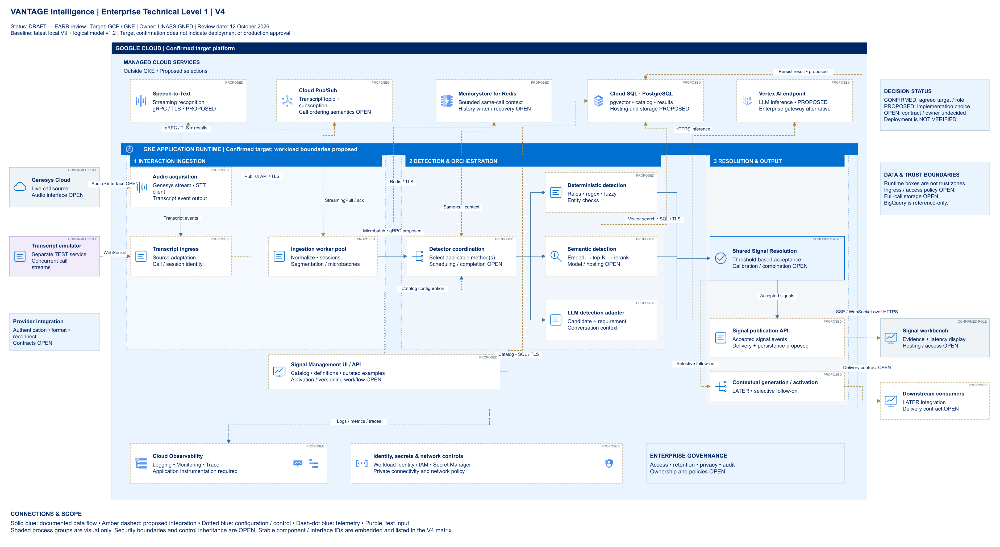

# VANTAGE Intelligence | Enterprise Technical Architecture | GCP/GKE | Level 1

| Metadata | Value |
|---|---|
| Architecture Version | V4 |
| Platform | Google Cloud / Google Kubernetes Engine |
| Architecture Type | Enterprise Technical Level 1 |
| Architecture Status | Proposed / Under Review — DRAFT for EARB review |
| Document Owner | TBD — not assigned in the architecture records |
| Last Updated | 12 October 2026 |
| Decision Baseline | Latest local V3 with process containers; logical architecture model v1.2; V4 review refinements |
| Related Architecture Decisions | [V4 architecture decision register](./v4/architecture-decision-register-v4.md) |
| Review Evidence | [Principal Architect review register](./v4/architecture-review-register.md) |

This page describes target behavior and a proposed technical implementation. It does not establish production deployment, measured performance, enterprise control compliance or EARB approval. Named stakeholder roles are proposed decision owners; accountable individuals remain to be assigned.

## 1. Solution Overview

VANTAGE Intelligence is intended to identify configurable business signals during active customer conversations and make accepted outcomes available quickly enough to support the current interaction. The target architecture includes a proposed live-audio acquisition path from Genesys Cloud, streaming speech recognition and transcript-event processing. A separate transcript emulator supplies controlled test streams, including concurrent calls. The actual Genesys audio contract, transcription engine suitability and measured benefit remain under evaluation.

Incoming transcript events retain their call/session identity and enter a queue before concurrent ingestion workers normalize events, assemble utterance windows and maintain bounded conversation context. Detector coordination determines which catalog signals apply and selects their configured deterministic, semantic or LLM-based detection methods. Results from invoked methods pass through Shared Signal Resolution, the common threshold-based acceptance boundary. Threshold interpretation, score calibration and multi-method combination rules remain open; the diagram does not prescribe simultaneous execution of all methods.

Google Cloud and GKE are the agreed target platform and runtime. Managed messaging, state, storage, inference and observability products are proposed implementation choices, while GKE hosts the candidate application workloads. Accepted signals can be exposed to a real-time workbench with supporting evidence and latency information. Contextual generation and downstream activation are later, selective capabilities that remain distinct from core signal detection.

## 2. Technical Architecture Diagram

[Editable draw.io architecture](./v4/vantage-gcp-gke-technical-level-1-v4.drawio) · [Scalable SVG](./v4/vantage-gcp-gke-technical-level-1-v4.svg)

The left side shows the external conversation source, acquisition concerns and separate test emulator. The center contains the Google Cloud platform and GKE application runtime. Managed cloud services appear above the runtime and remain outside the GKE boundary. The right side shows shared resolution, signal publication, the workbench and later consumers. Shared security, observability and governance appear along the bottom.

The three shaded process groups distinguish Interaction Ingestion, Detection & Orchestration, and Resolution & Output. They are visual groupings, not independently approved deployment units or security zones. The GCP and GKE borders indicate platform and runtime placement; network trust and access policies remain open.

| Decision label | Meaning |
|---|---|
| CONFIRMED | Documented agreed target or functional responsibility; not evidence of deployment |
| PROPOSED | Recommended implementation, technology or interface requiring approval |
| OPEN | Technology, contract, ownership or behavior not finalized |

| Connector notation | Meaning |
|---|---|
| Solid blue | Documented logical processing or data flow; does not by itself confirm synchronous transport |
| Dashed amber | Proposed integration or interface |
| Dotted blue | Configuration or control relationship |
| Dash-dot blue | Telemetry relationship |
| Purple | Test-only input interface |

**Confluence publishing note:** The relative image and document links work within the repository. When publishing to Confluence, attach the V4 PNG to the page and insert that attachment at the diagram position if relative Markdown images are not preserved. Attach the draw.io file for editing and optionally the SVG for scalable viewing. Replace repository-relative document links with their Confluence page, attachment or published repository equivalents. If pasting raw Markdown does not convert headings and tables, use the Markdown-capable import/paste workflow available in your organization's editor. No Confluence page has been created or published by this deliverable.

## 3. Architecture Description

### 3.1 Conversation Sources and Data Acquisition

Genesys Cloud is the identified enterprise conversation source. The proposed audio acquisition adapter obtains a live audio stream and acts as a streaming speech-to-text client. Recognition results return through the adapter and become transcript events for ingress. Google Cloud Speech-to-Text is proposed for this responsibility; the gRPC/TLS interaction is a technical proposal, not a verified provider integration.

The separate transcript emulator supplies WebSocket transcript input for controlled testing. It supports the required test direction of multiple distinguishable calls without establishing production capacity. Call ID as session/correlation ID is a documented prototype convention; production uniqueness, speaker/channel metadata, timestamps and identity propagation require a contract.

Provider authentication, audio format, partial-versus-final recognition, revision handling, reconnect and out-of-order behavior remain OPEN. Whether provider-produced transcripts coexist with new speech recognition, serve as a comparison/fallback or are replaced is not decided. Direct audio-native detection is not selected in V4.

**Architecture references:** `genesys`, `bridge`, `stt`, `test`; interfaces `edge-1`–`edge-4`; decisions V4-D02/V4-D03.

### 3.2 Real-Time Transcript Ingestion

The transcript ingress service adapts the source envelope, preserves call/session identity and publishes incoming transcript events. In the current queue-before-workers design, source adaptation at ingress is distinct from the ingestion workers' event normalization, session management, segmentation and windowing responsibilities. Normalization is not silently moved ahead of the queue.

Concurrent ingestion workers consume queued events, assemble independent microbatches and maintain the context needed for the same conversation. Workers then pass microbatches and relevant metadata to detector coordination. Their GKE workload packaging is proposed. The internal gRPC interface is also proposed; it is not an approved payload or scheduling contract.

The canonical event schema, metadata requiredness, sequence/revision rules, microbatch size, flush condition and overlapping-window policy remain OPEN. Multiple workers do not by themselves establish safe parallel mutation of one call's state.

**Architecture references:** `ingress`, `worker`; `edge-5`–`edge-8`; V4-D02/V4-D07.

### 3.3 Event Streaming and Messaging

A buffering queue between transcript ingress and processing workers is a confirmed architectural direction. Cloud Pub/Sub is the proposed broker implementation, represented by a topic and subscription. Ingress publishes call-identified events, while workers consume through the proposed subscription interface and acknowledge according to a policy still to be defined.

This boundary decouples transcript producers from worker execution and supports concurrent calls across a scalable worker pool. Call identity remains necessary throughout the path; the design does not prescribe one queue per call or a fixed number of partitions, workers or threads.

Per-call ordering, acknowledgement timing, publisher retries, duplicate processing, replay, dead-letter handling, retention and backpressure remain OPEN. An ordering key is a proposal, not proof of ordered application state updates. No exactly-once business processing or demonstrated no-loss guarantee is claimed.

**Architecture references:** `queue`, `ingress`, `worker`; `edge-5`/`edge-6`; V4-R15/V4-R16.

### 3.4 Signal Management and Configuration

Signal Management UI/API provides the capability to manage signal definitions and their supporting catalog assets. A definition describes the business condition independently of the code that evaluates it, while its method-specific configuration identifies how that condition should be detected. Configuration can include applicability criteria, a selected detection method and threshold-related parameters; the final schema is not approved.

Planning material includes domain/group taxonomy, descriptions, product/speaker scope, entity references, positive and negative examples, requirement references and version/lifecycle information. These are design inputs, not proof that every field is mandatory or implemented. Curated examples and semantic representations support candidate retrieval. Catalog/example persistence in Cloud SQL and the publication workflow for embeddings remain proposals.

Signal Management supplies applicability and detector configuration to coordination. Ownership of authoring approval, version activation, rollback, index compatibility and configuration changes during an active call remains OPEN. Regulatory-reference metadata is not evidence that a signal constitutes a validated regulatory assessment.

**Architecture references:** `management`, `sql`, `coord`; `edge-18`/`edge-19`; V4-D04/V4-D12.

### 3.5 Detector Coordination and Orchestration

Detector coordination evaluates which catalog signals apply to a conversation using available call metadata and context. It then invokes the configured detection strategy or strategies. The applicability behavior is confirmed; predicates, metadata ownership and missing/changed-metadata handling are not finalized.

**Deterministic, semantic and LLM detection are selectable strategies, not mandatory simultaneous processing paths.** The fan-out in the diagram expresses available evaluation paths. It does not select parallel execution, a mandatory sequence or a fallback chain.

Invocation conditions, deadlines, timeouts, partial-result handling and detector completion semantics remain OPEN. Coordination's exact GKE service boundary and whether it shares a process with detector modules are implementation decisions. The architecture must not infer acceptance merely because one invocation timed out or another completed first.

**Architecture references:** `coord`; `edge-9`–`edge-12` and `edge-18`; V4-R05/V4-R06.

### 3.6 Deterministic Signal Detection

The deterministic engine evaluates configured rules, regular expressions, fuzzy matches and entity-based conditions. It supports comparatively direct, explainable signal checks where a defined condition can be evaluated against transcript content or structured context. Actual precision, latency and resource use still require scenario-based measurement.

A match contributes evidence to Shared Signal Resolution. The evidence contract should identify the evaluated condition and relevant utterance/context, but its required fields and deterministic score representation are OPEN. Exact phrasing tolerance, transcription normalization and omission/sequence timing cannot be inferred from the presence of a rules engine. A mandatory entity-extraction stage before all detection is not approved.

**Architecture references:** `rules`, `resolver`; `edge-10`/`edge-13`; V4-D04/V4-D06.

### 3.7 Semantic Signal Detection

The semantic path represents an utterance through an embedding, retrieves top-K candidate signals or examples from vector representations, and reranks candidates for relevance. Reranking compares the utterance with candidate signal descriptions to contribute more focused evidence to resolution. The path retains both candidate retrieval and reranking; it does not reintroduce the deferred trained-classifier implementation.

PostgreSQL/pgvector is the documented vector-storage direction, with Cloud SQL as a proposed hosting option. The embedding model, reference corpus, reranker artifact/version, hosting, K, retained output count and threshold parameters remain OPEN. The Vertex AI endpoint drawn for LLM inference does not automatically host embeddings or reranking.

Similarity and reranker scores must not be treated as calibrated probabilities without validation. Candidate evidence proceeds to the same acceptance boundary as the other methods.

**Architecture references:** `semantic`, `sql`, `resolver`; `edge-11`, `edge-14`, `edge-17`; V4-D04/V4-D06.

### 3.8 LLM-Based Signal Detection

The LLM detection adapter evaluates a candidate and its signal requirements using conversation context. Vertex AI is the proposed inference integration, with an approved enterprise model gateway retained as an alternative. Neither a specific model nor a deployed endpoint has been confirmed.

Structured candidate/evidence output and validation against an agreed result contract are design requirements to settle before implementation. Prompt/configuration versions, evidence grounding, malformed-output handling, invocation authorization, request limits, deadlines and fallback behavior require explicit decisions. An LLM response is not an accepted signal until it passes Shared Signal Resolution.

Model invocation introduces latency, capacity and cost considerations that require measurement against representative calls. No cost figure or token budget is established. No implementation or mock-adapter inspection establishes the endpoint in this architecture: accessible Python code generates diagrams, not a verified LLM POC.

**Architecture references:** `llm`, `model`, `resolver`; `edge-12`, `edge-15`, `edge-16`; V4-D06/V4-D08/V4-D12.

### 3.9 Shared Signal Resolution

Shared Signal Resolution is the confirmed common acceptance boundary for results from all invoked detection methods. It applies configured threshold criteria to decide which candidate signals are accepted. This preserves one acceptance responsibility across deterministic, semantic and LLM evaluation.

A common candidate/evidence representation and evidence-validation rules are needed, but their schema and normalization behavior remain OPEN. Normalizing an evidence envelope would not make raw method scores interchangeable. Per-method/per-signal threshold scope, calibration, conflicts, duplicate signals, late evidence and multi-method combination rules require agreement.

Rejection, abstention and finality behavior are not yet defined. Decision provenance should connect outcomes to evidence and relevant input/configuration/model versions; the durable owner and required fields are proposals to resolve. No weighted scoring, consensus, any-path acceptance or mandatory all-path waiting policy is selected.

**Architecture references:** `resolver`; `edge-13`–`edge-15`, `edge-20`; V4-D05/V4-D06.

### 3.10 Conversation Context Management

Detection requires bounded context from the same conversation, including recent utterances and previously identified signals. Memorystore for Redis is proposed as the shared context service for ingestion and detector access. The diagram shows ingestion maintaining recent context and coordination obtaining same-call context.

The cache is working state, not an approved permanent system of record. Window limits, expiry, eviction, call-end cleanup, state ownership during worker movement and recovery after failure remain OPEN. Call identity must scope every lookup and update; it does not alone guarantee isolation or serialization.

Accepted-signal history has a specific unresolved ownership gap: the required prior-signal context is documented, but the component that writes accepted signals and the moment they become visible to later batches are not selected. V4 deliberately does not invent a write-back arrow.

**Architecture references:** `state`, `worker`, `coord`; `edge-8`/`edge-9`; V4-D07 and V4-R11.

### 3.11 Signal Persistence and Data Storage

Cloud SQL for PostgreSQL with pgvector is proposed for catalog/example storage, semantic retrieval and accepted-result records. Signal Management accesses proposed catalog storage; semantic detection performs vector retrieval; the publication path has a proposed accepted-result persistence mapping. These relationships do not establish a final transaction or source-of-truth boundary.

Earlier meetings reported a PostgreSQL vector instance and GKE setup direction. That report is documented, but instance identity, extension/version, readiness and capacity have not been verified. It must not be presented as confirmed operational capability. Reusing an existing approved PostgreSQL instance remains an alternative to Cloud SQL deployment.

The structured result/event contract, evidence and metadata fields, authoritative accepted-signal history, retention, replay and audit requirements remain OPEN. Full-call storage has no selected destination. BigQuery is reference-only. Business records, cache state and operational logs must not be assumed to have the same authority or lifecycle.

**Architecture references:** `sql`, `management`, `semantic`, `publisher`; `edge-17`, `edge-19`, `edge-22`; V4-D08/V4-D09.

### 3.12 Signal Publication and Workbench

The signal publication capability exposes accepted signals to the real-time workbench. The workbench is intended to display signal evidence and latency information so that a reviewer can understand both the result and processing delay. Exact event fields, correlation requirements and UI behavior need an agreed contract.

SSE or WebSocket over HTTPS is a retained delivery proposal, not an approved consumer protocol. User/consumer authorization, hosting, connection lifecycle, reconnection, replay, duplicate handling and delivery guarantees remain OPEN. Publication and result persistence may fail separately; consistency and retry ownership must be decided before implementation.

**Architecture references:** `publisher`, `workbench`; `edge-20`–`edge-22`; V4-R19.

### 3.13 Contextual Generation and Activation

An accepted signal may selectively trigger further context assembly, recommendations or generation. Activation then delivers the resulting outcome to downstream consumers through an interface still to be defined. These are later capabilities whose technical placement is proposed.

Contextual generation is not required for every detected signal and is not the same responsibility as LLM-based signal detection. Its presence in the output group does not make it a blocking prerequisite for acceptance or workbench display. Selection rules, additional context, authorization, delivery and failure behavior remain OPEN; no specific consumer product is selected.

**Architecture references:** `later`, `consumers`; `edge-23`/`edge-24`; V4-D11.

### 3.14 GKE Application Runtime

GKE is the confirmed target runtime. The diagram groups candidate workloads into interaction ingestion, detection/orchestration and resolution/output, with Signal Management shown as shared application support. Cloud-managed services remain outside the GKE boundary.

Each box expresses a responsibility, not necessarily an independent Kubernetes Deployment. Audio acquisition involves long-lived sessions; workers assemble call-scoped state; coordination and resolution may have configuration and decision-state requirements. Stateless execution cannot be assumed simply because shared storage exists.

Scaling, failure isolation, service communication, readiness/health monitoring, graceful shutdown and deployment ownership require detailed design. Resources must be informed by concurrent-call, transcription, vector and model workloads. No pod count, node pool, resource limit or autoscaling threshold is selected in Level 1.

**Architecture references:** `gke` and the three process containers; V4-R09/V4-R10; [runtime matrix](./v4/component-interface-matrix-v4.md).

### 3.15 Enterprise Security and Governance

Workload Identity Federation for GKE, IAM, Secret Manager and network controls are proposed shared controls. They require enterprise platform confirmation, workload-specific authorization and a defined ingress/egress policy. The diagram does not establish that a gateway, private endpoint, service-to-service authentication scheme or key-management configuration is deployed.

Sensitive audio, transcripts, context, model requests, results and logs require classification and approved handling. Transport/storage encryption requirements, key ownership, retention/deletion, model access, authorization and auditability remain decisions to ratify. Protocol labels such as TLS are proposals, not implementation test results.

Enterprise platform teams may own organization/network/cluster foundations and approved identity, secret and audit services. VANTAGE would need application-specific enforcement, call-context isolation, safe model/log handling and provenance. This division is a proposed responsibility model, not verified control inheritance. No complete internal enterprise standard or named control owner was provided.

**Architecture references:** `controls`, `governance`; V4-D13 and V4-R13/V4-R14.

### 3.16 Observability and Operational Monitoring

End-to-end logging/tracing is a documented requirement. Cloud Logging, Cloud Monitoring and Cloud Trace are proposed implementations. The aggregate telemetry connector represents system/application instrumentation rather than another business-processing stage.

Proposed measurements include call/event correlation, stage duration, queue backlog and message age, detector completion/error rates, model request latency and failures, database/cache delays and publication/UI delivery. P50/P95/P99 should be assessed per stage and for relevant end-to-end paths; clock strategy, correlation envelope and sampling are OPEN.

Detector quality monitoring also needs approved labels and false-positive/false-negative analysis. None of these dashboards, traces, alerts or evaluation capabilities has been validated as operational. Telemetry access, sensitive-data filtering, retention, incident ownership and cost require agreement.

**Architecture references:** `telemetry`; `edge-25`; V4-R03/V4-R04/V4-R17.

## 4. End-to-End Processing Flow

This representative flow follows the proposed live-audio route. Test transcripts enter at step 3. It illustrates documented responsibilities, not a validated runtime sequence or guarantee.

1. **Acquire call audio — `genesys` → `bridge` (`edge-1`).** The proposed adapter receives audio under a provider contract that remains OPEN. Call/session identity must be retained.
2. **Recognize speech — `bridge` ↔ `stt` (`edge-2`).** The proposed STT client sends streaming audio and receives recognition results. Partial/final and revision behavior require agreement.
3. **Receive transcript events — `bridge` → `ingress` (`edge-3`).** Ingress adapts the source envelope and preserves identity. The separate `test` source can supply WebSocket transcripts through `edge-4`.
4. **Queue the event — `ingress` → `queue` (`edge-5`).** Call-identified events enter the buffering boundary. Pub/Sub publication is proposed; producer acknowledgement/retry behavior remains OPEN.
5. **Process the session — `queue` → `worker` (`edge-6`).** Workers normalize events, segment/window utterances and form microbatches. Ordering, revisions, acknowledgement timing and concurrent ownership of a call remain OPEN.
6. **Maintain and consult context — `worker` → `state`, `state` → `coord` (`edge-8`/`edge-9`).** Recent context is scoped to the same call. Prior-signal history is required, but its writer is unresolved.
7. **Select applicable evaluations — `worker` → `coord`, with `management` configuration (`edge-7`/`edge-18`).** The coordinator evaluates catalog applicability and chooses configured methods; no all-path execution is implied.
8. **Generate evidence — `rules`, `semantic` and/or `llm` (`edge-10`–`edge-17`).** Invoked methods return evidence. Semantic retrieval uses the proposed SQL/vector dependency; LLM inference uses the proposed model endpoint. Completion and failure policy remain OPEN.
9. **Resolve acceptance — methods → `resolver` (`edge-13`–`edge-15`).** Common resolution applies configured acceptance criteria. Threshold interpretation, combined results and finality are unresolved.
10. **Publish accepted signals — `resolver` → `publisher` → `workbench` (`edge-20`/`edge-21`).** Accepted outputs support evidence and latency display. The proposed persistence write (`edge-22`) does not define write/publish transactionality or ordering.
11. **Optionally activate — `resolver` → `later` → `consumers` (`edge-23`/`edge-24`).** A selected accepted signal may initiate later contextual generation/activation. This is not mandatory for detection.
12. **Observe the path — `gke` → `telemetry` (`edge-25`).** Proposed instrumentation records correlated operational measurements throughout the flow, subject to approved data-handling controls.

## 5. Technology Stack

The status column separates confirmed responsibility from proposed technology or packaging. References identify stable diagram IDs and V4 decisions.

| Architecture Component | Proposed/Confirmed Technology | Responsibility | Deployment Boundary | Decision Status | Supporting Architecture Reference |
|---|---|---|---|---|---|
| Conversation source | Genesys Cloud | Source live conversation data | External enterprise platform | CONFIRMED source; audio contract OPEN | `genesys`; V4-D03 |
| Transcript emulator | Framework/hosting not selected | Separate concurrent-call test source | Separate service; hosting OPEN | CONFIRMED separate role | `test`; V4-D02 |
| Audio acquisition | Adapter technology not selected | Provider stream and STT client | GKE workload proposed | PROPOSED integration/packaging | `bridge`; V4-D03 |
| Speech recognition | Google Cloud Speech-to-Text | Streaming transcription | GCP managed service, outside GKE | PROPOSED | `stt`; V4-D08 |
| Ingress and worker processing | Application framework not selected | Adapt, enqueue, normalize and assemble call windows | GKE workloads proposed | CONFIRMED responsibilities; packaging PROPOSED | `ingress`, `worker`; V4-D02 |
| Messaging | Cloud Pub/Sub | Decouple ingress and processing | GCP managed service, outside GKE | Queue role CONFIRMED; product PROPOSED | `queue`; V4-D02/V4-D08 |
| Application runtime | Google Kubernetes Engine | Host application workloads | Google Cloud | CONFIRMED target; deployment unverified | `gke`; V4-D01 |
| Signal Management | UI/API technology not selected | Catalog and method-aware configuration | GKE packaging proposed | CONFIRMED capability; implementation PROPOSED | `management`; V4-D04/V4-D12 |
| Coordination and deterministic engine | Application technology not selected | Applicability, configured invocation and rule evaluation | GKE modules/services proposed | CONFIRMED behavior; packaging/scheduling open | `coord`, `rules`; V4-D04 |
| Semantic engine | Embedding/top-K/reranker; models OPEN | Candidate retrieval and reranked evidence | GKE workload; model hosting OPEN | CONFIRMED path; implementation OPEN | `semantic`; V4-D04 |
| LLM detection | Vertex AI endpoint; enterprise model gateway alternative | Requirement/context evaluation | GKE adapter to managed inference | PROPOSED endpoint; model OPEN | `llm`, `model`; V4-D08 |
| Shared resolution | Application technology not selected | Common threshold acceptance | GKE packaging proposed | CONFIRMED role; acceptance details OPEN | `resolver`; V4-D05/V4-D06 |
| Conversation state | Memorystore for Redis | Bounded same-call working state | GCP managed service, outside GKE | PROPOSED product; lifecycle OPEN | `state`; V4-D07/V4-D08 |
| Catalog/vector/result persistence | Cloud SQL for PostgreSQL + pgvector; existing PostgreSQL alternative | Candidate catalog, vector and accepted-record storage | Managed service outside GKE | Cloud SQL hosting/mapping PROPOSED; existing readiness unverified | `sql`; V4-D08/V4-D09 |
| Publication/workbench | SSE or WebSocket over HTTPS proposed | Accepted signals, evidence and latency display | Publisher GKE proposed; UI hosting OPEN | Capability CONFIRMED; contracts OPEN | `publisher`, `workbench`; V4-R19 |
| Generation/activation | Technologies and consumers not selected | Selective follow-on outcomes | Later capability; placement proposed | CONFIRMED concern; integration OPEN | `later`, `consumers`; V4-D11 |
| Observability | Cloud Logging, Cloud Monitoring, Cloud Trace | Correlated logs, metrics and traces | Managed services plus application instrumentation | PROPOSED products; telemetry requirement CONFIRMED | `telemetry`; V4-D08 |
| Shared security | Workload Identity, IAM, Secret Manager, network controls | Identity, credentials and access foundations | Shared enterprise/cloud controls | PROPOSED; inheritance OPEN | `controls`; V4-D08/V4-D13 |

No FastAPI, application language, graph database, mandatory Graph RAG, additional LLM-response cache or new gateway is selected through this document.

## 6. Non-Functional Architecture Considerations

| Concern | Architecture consideration | Current objective or evidence |
|---|---|---|
| Latency and throughput | Measure speech recognition, queue wait, window assembly, detector dependencies, resolution and visible delivery separately; assess P95/P99 and event age | **TBD — requires validation.** Historical internal POC targets are not a V4 production SLA |
| Scalability | Scale concurrent calls within provider, worker, state, database and model limits; preserve call-correct ownership | **TBD — requires validation.** No production workload envelope or autoscaling threshold established |
| Availability | Assess source, broker, cache, database, model and consumer dependencies separately | **TBD — requires validation.** No approved availability objective or deployment topology |
| Reliability | Define acknowledgement, deduplication, idempotency and replay boundaries | **TBD — requires validation.** No demonstrated exactly-once or no-loss outcome |
| Security | Approve authentication, authorization, network boundaries and workload permissions | **TBD — requires validation.** Products shown are not proof of implemented controls |
| Privacy | Classify conversation data and approve model, log and storage handling | **TBD — requires validation.** No approved processing/retention policy evidenced |
| Data retention | Distinguish transient context, source events, accepted records, full-call history and telemetry | **TBD — requires validation.** Durations, deletion and source-of-truth ownership remain OPEN |
| Fault tolerance | Test worker restart, lost context, model timeouts, storage failures and consumer reconnect | **TBD — requires validation.** Graceful degradation and recovery objectives are not defined |
| Observability | Establish correlation, latency distributions, queue age, dependency errors and quality metrics | **TBD — requires validation.** Instrumentation proposal, not a deployed monitoring capability |
| Cost optimization | Measure STT utilization, model requests, vector work, state size and telemetry volume; use method applicability to avoid unnecessary evaluation | **TBD — requires validation.** No cost baseline or budget approved |
| AI quality and evaluation | Use approved scenarios, golden data, per-signal false-positive/false-negative analysis and version traceability | **TBD — requires validation.** Quality thresholds, feedback ownership and drift workflow are OPEN |

## 7. Architecture Decisions and Open Questions

The table summarizes the [V4 decision register](./v4/architecture-decision-register-v4.md). Owner roles are suggested stakeholders; every named individual is TBD.

| Decision ID | Topic | Current Understanding | Status | Required Decision | Owner | Impact |
|---|---|---|---|---|---|---|
| V4-D01 | Platform | GCP/GKE are targets | CONFIRMED target | Verify environment and platform ownership | TBD — platform/architecture | Implementation readiness |
| V4-D02 | Ingestion | Separate emulator and queue-before-workers | CONFIRMED behavior | Finalize event/concurrency contracts | TBD — ingestion | Call isolation and scaling |
| V4-D03 | Live audio/STT | Audio acquisition and transcription are proposed | PROPOSED; contract OPEN | Confirm provider access, STT and transcript revisions | TBD — integration/speech | Feasibility, quality, latency |
| V4-D04 | Detection | Applicable signals select deterministic, semantic or LLM methods | CONFIRMED behavior; scheduling OPEN | Define invocation, completion and fallback | TBD — detection | Outcome consistency and latency |
| V4-D05 | Acceptance boundary | All invoked methods feed Shared Signal Resolution | CONFIRMED | Define detailed acceptance contract | TBD — signal/ML | Common decision ownership |
| V4-D06 | Resolution semantics | Thresholds exist conceptually; scores and combinations unresolved | OPEN | Decide calibration, evidence, duplicates, conflict and abstention/finality | TBD — signal owner/SME | False acceptance or rejection |
| V4-D07 | Conversation state | Bounded same-call context includes prior signals | CONFIRMED scope; ownership OPEN | Assign history writer, expiry and recovery | TBD — data/ingestion/detection | Sequence correctness |
| V4-D08 | Managed products | Named GCP products are recommendations | PROPOSED | Obtain enterprise approval and capability evidence | TBD — service owners | Hosting and dependency selection |
| V4-D09 | Data authority | Existing PostgreSQL remains alternative; durable history unresolved | OPEN | Approve stores, retention and publication consistency | TBD — data/records | Replay and auditability |
| V4-D10 | Scope exclusions | BigQuery reference-only; no new caches/graphs/classifier/gateway | Retained scope | Explicit architecture decision before adding dependencies | TBD — architecture | Prevent unsupported expansion |
| V4-D11 | Activation | Later selective generation and consumer delivery | CONFIRMED concern; integration OPEN | Define selection and consumer contract | TBD — product/downstream | Separation from core detection |
| V4-D12 | AI/configuration governance | Versioning and evaluation discipline proposed | PROPOSED; implementation OPEN | Approve datasets, lifecycle and reviewers | TBD — AI governance/SME | Reproducibility and quality |
| V4-D13 | Governance authority | Owner, standards and control inheritance unassigned | OPEN | Assign accountable owners and applicable standards | TBD — EARB/security | Approval and control evidence |
| V4-D14 | Representation | Stable IDs, traceability and boundary/status refinements applied | Applied presentation change | Review V4 notation; no runtime approval implied | TBD — architecture reviewer | Review clarity |

## 8. Architecture Risks and Mitigations

The documentation gaps are observed in the baseline. Their consequences are potential risks requiring validation, not confirmed production failures. Proposed mitigations are not implemented controls.

| Review Findings | Area | Observed Gap and Potential Consequence | Proposed Mitigation | Priority |
|---|---|---|---|---|
| V4-R01/R02 | Genesys integration | Unverified audio/revision contracts could prevent reliable acquisition or associate stale evidence with a call | Obtain provider contracts; test reconnect, revisions and concurrent identity propagation | High |
| V4-R03/R04 | Real-time performance | No measured load/latency budget; queueing, windows and model/DB calls may delay useful signals | Approve workload envelope and measure stage/tail latency with saturation and backpressure tests | High |
| V4-R05/R06 | Orchestration | Scheduling and configuration activation unresolved; methods could wait unnecessarily or use mismatched versions | Define per-signal invocation/completion and catalog/index activation policies | High |
| V4-R07/R08 | Resolution | Uncalibrated scores and incomplete decision lifecycle may produce inconsistent acceptance | Agree evidence and method-specific threshold semantics, provenance and finality; validate with business labels | Critical / High |
| V4-R11/R12/R15/R16 | Persistence and recovery | Prior-signal writer, durable authority and replay/ack rules unresolved; state could be missing or duplicated | Assign data/state owners and test restart, retries, replay and write/publish failures | Critical / High |
| V4-R09/R10 | GKE boundaries | Logical boxes could be over-decomposed or scaled without safe call ownership | Decide workload units after state, resource and failure-isolation analysis | Medium / High |
| V4-R13/R14 | Security and privacy | No approved live-data trust/control inheritance evidence; unauthorized access or handling is a potential consequence | Assign enterprise/application controls and approve classification, authorization, model use, retention and auditing | Critical |
| V4-R17/R18 | AI evaluation | Approved datasets, version governance and drift/human-review workflow missing | Establish reviewed golden scenarios, FP/FN evaluation and governed feedback/change processes | High / Medium |
| V4-R19/R20 | Consumers and activation | Delivery consistency and later-action contracts unresolved | Define authenticated publication/replay and keep optional activation outside mandatory acceptance | High / Medium |
| V4-R21/R22 | Representation | Ambiguous source references and boundary meanings could lead to incorrect approval assumptions | V4 applies traceability/status/boundary refinements; enterprise validation still required | Medium / High |

## 9. Implementation Roadmap

The following is a proposed implementation sequence, not an approved delivery plan, schedule or resource commitment. Work can overlap where dependencies allow; unresolved decisions require accountable owners.

### Phase 1 — Architecture Validation and Technical Decisions

Assign architecture, integration, data, security, signal and model owners. Confirm live-audio feasibility, source-event identity/revision contracts, selected business scenarios and applicability rules. Decide detector completion, acceptance semantics and state ownership. Approve technology choices and the data/security responsibility model. Exit evidence should include reviewed decisions and measurable evaluation criteria rather than only a diagram.

### Phase 2 — GCP/GKE Infrastructure and Integration Foundations

Validate the available GCP/GKE and PostgreSQL environments. Establish approved messaging, state, model access, secrets, identity and connectivity foundations. Extend the separate emulator and verify provider/STT connectivity where authorized. Instrument foundational integrations. This phase does not presume every proposed managed service will be selected.

### Phase 3 — Real-Time Ingestion and Detection Services

Implement the agreed ingress, queue and worker contracts with concurrent-call isolation, normalization and windowing. Implement catalog applicability and configured deterministic, semantic top-K/reranker and LLM evaluation. Build version-aware configuration and candidate-evidence handling according to approved contracts. Exercise revision, duplicate, timeout and backpressure behavior with representative scenarios.

### Phase 4 — Signal Resolution, Persistence, and Consumption

Implement calibrated acceptance/evidence policies, decision provenance and approved accepted-signal history updates. Implement the selected persistence/publication consistency boundary and authorized workbench delivery. Validate visible evidence, latency and replay behavior. Scope later contextual generation/activation separately; it is not automatically part of the first operational release.

### Phase 5 — Operational Readiness, Evaluation, and Governance

Run agreed load, fault and recovery tests; verify monitoring, privacy and access controls. Evaluate quality with approved golden datasets and business reviewers. Establish version/change controls, incident/run ownership and a governed feedback process. Record evidence for operational and EARB review before any production-readiness claim.

## 10. References

| Reference | Purpose |
|---|---|
| [V4 editable draw.io](./v4/vantage-gcp-gke-technical-level-1-v4.drawio) | Editable technical architecture |
| [V4 PNG](./v4/vantage-gcp-gke-technical-level-1-v4.png) | Confluence/presentation attachment |
| [V4 SVG](./v4/vantage-gcp-gke-technical-level-1-v4.svg) | Scalable diagram export |
| [Component inventory](../component-inventory.md) | Logical component responsibilities and source evidence |
| [Integration matrix](../integration-matrix.md) | Logical relationships and qualifications |
| [V4 component/interface matrix](./v4/component-interface-matrix-v4.md) | Stable technical IDs, interfaces and runtime considerations |
| [V4 architecture decision register](./v4/architecture-decision-register-v4.md) | Current dispositions, data authority, security responsibilities and measurement plan |
| [Decision history](../decisions.md) | Historical decisions and superseding qualifications |
| [Open questions](../open-questions.md) | Unresolved contracts and design choices |
| [Principal Architect review register](./v4/architecture-review-register.md) | 22 findings across ten review domains |
| [V4 compliance and validation checklist](./v4/enterprise-architecture-compliance-checklist.md) | Completed checks and verification limits |
| [V4 automated validation report](./v4/validation.json) | XML, identity, preservation, icon and boundary checks |
| [V3–V4 change summary](./v4/v3-v4-change-summary.md) | Representation changes and preserved behavior |
| [Logical architecture model](../architecture-model.json) | Machine-readable v1.2 source baseline |
| [Icon inventory](./v3/technology-icon-inventory.md) | Official/neutral icon provenance and reuse qualifications |

**Documentation consistency:** This page follows the V4 diagram's 25 interfaces and component responsibilities. It introduces no new approved runtime component or technical contract. The architecture artifacts passed structural checks and generated-preview inspection; native organizational draw.io import, production behavior and formal enterprise compliance remain unverified. Relative links and the image path were checked against local files. Confluence rendering and attachment placement must be checked in the target page after paste/import.
